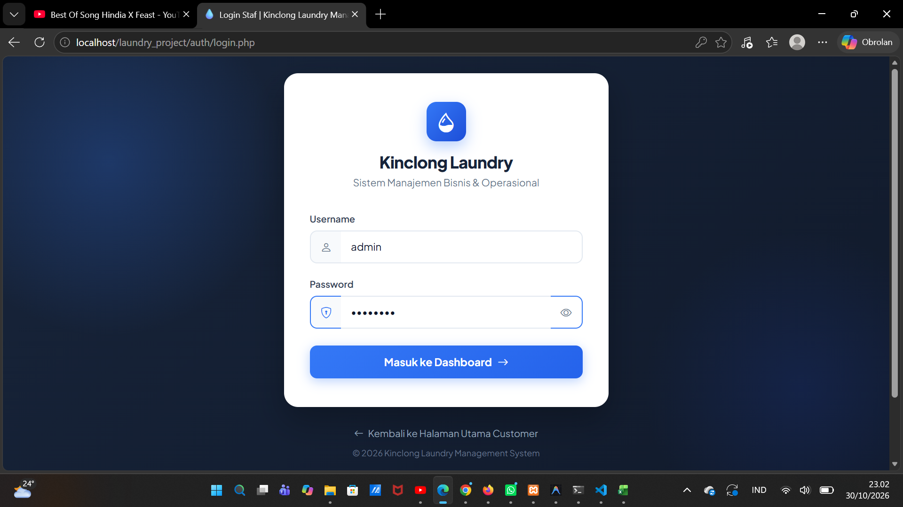
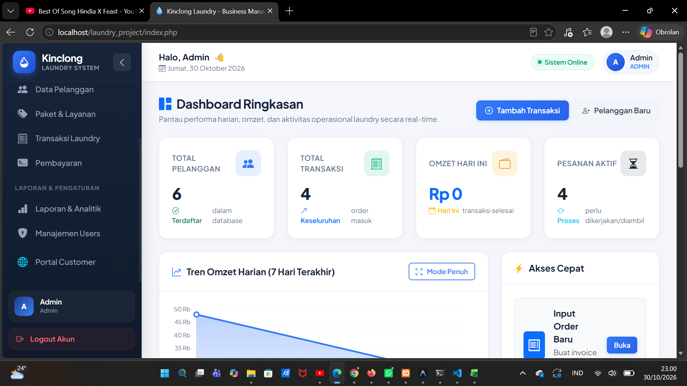
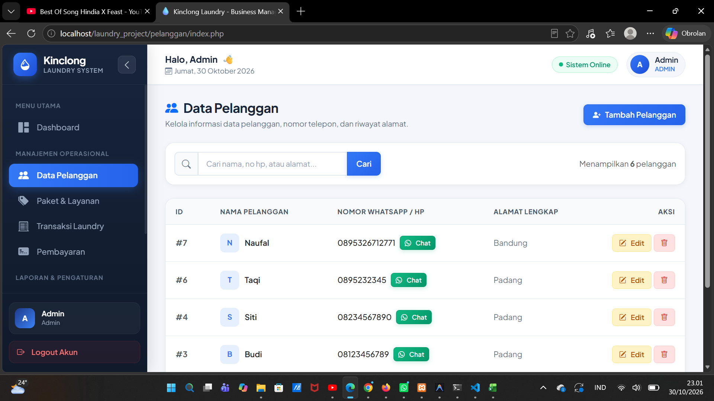
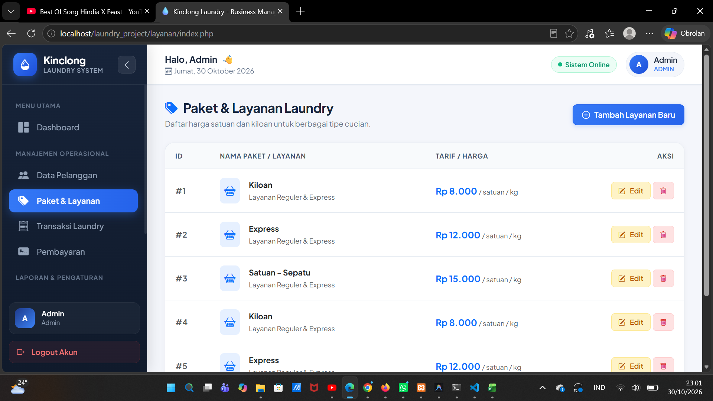
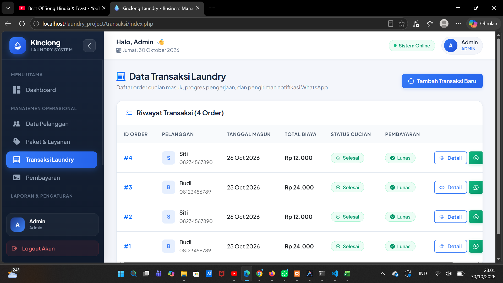
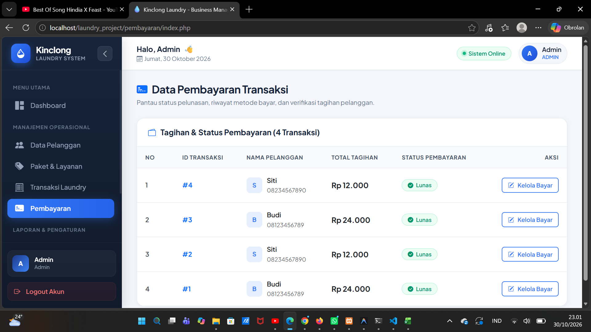
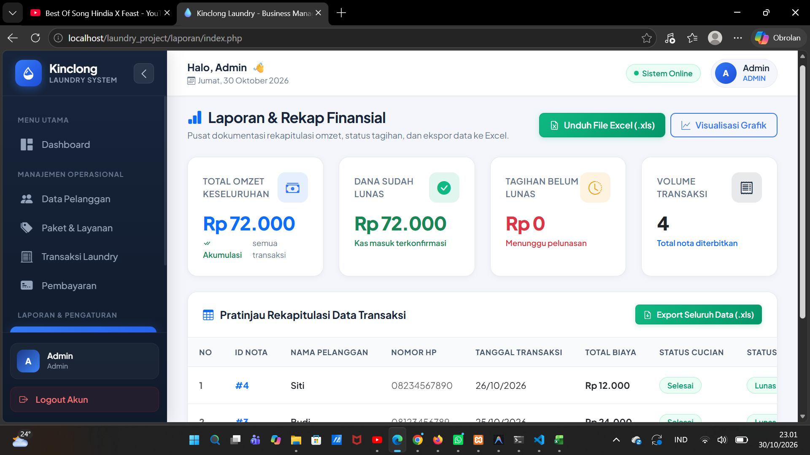

# 🧺 Sistem Manajemen Laundry

Aplikasi berbasis web yang dikembangkan untuk membantu pengelolaan operasional usaha laundry agar lebih mudah, terstruktur, dan efisien.

Sistem ini menyediakan fitur pengelolaan data pelanggan, layanan laundry, transaksi, pembayaran, serta laporan pendapatan.

## 🚀 Teknologi yang Digunakan

- PHP
- MySQL
- HTML
- CSS
- JavaScript
- Bootstrap

## ✨ Fitur Utama

- **Login dan Autentikasi:** Sistem login untuk pengguna.
- **Dashboard:** Menampilkan ringkasan informasi operasional laundry.
- **Manajemen Pelanggan:** Mengelola data pelanggan.
- **Manajemen Layanan:** Mengelola jenis layanan dan harga laundry.
- **Manajemen Transaksi:** Mengelola transaksi laundry.
- **Manajemen Pembayaran:** Mencatat pembayaran pelanggan.
- **Status Pengerjaan:** Memantau proses pengerjaan laundry.
- **Laporan:** Menampilkan laporan transaksi dan pendapatan.
- **Cetak Laporan:** Mendukung pencetakan laporan.

## 📸 Dokumentasi Aplikasi

### 1. Halaman Login


### 2. Dashboard


### 3. Data Pelanggan


### 4. Data Layanan


### 5. Transaksi


### 6. Pembayaran


### 7. Laporan


## ⚙️ Instalasi dan Menjalankan Aplikasi

### Persyaratan
- PHP
- MySQL
- XAMPP
- Web Browser

### Langkah Instalasi

1. Clone repository:

   ```bash
   git clone URL_REPOSITORY